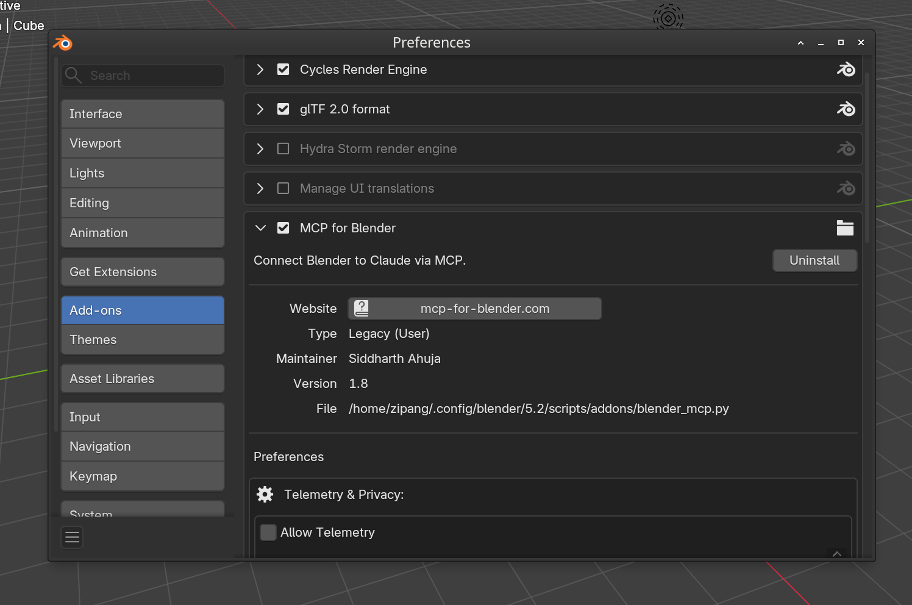
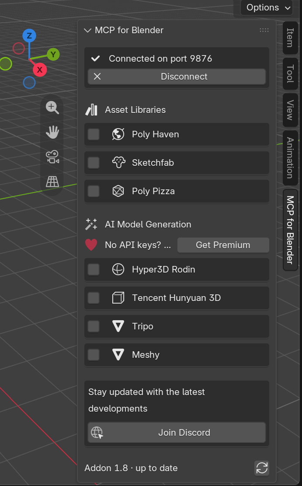

# Bender — 3D models Workflows

This repository is a test lab for 3D asset workflows. It compares tools and pipelines for interactive web animation with **Three.js**, **React Three Fiber**, WebGL, and WebGPU.

## Project goals

0. **Prepare the references before modeling:**
   - Gather subject and style reference images for a draft in `blueprints/drafts/<draft>/`.
   - Combine them into one reference image on a uniform white field.
   - Generate the six orthographic views from that reference image.
   - Let the art director accept one view per face.
1. **Compare and combine AI-assisted 3D modeling approaches:**
   - Polygon modeling, organic shapes, PBR materials, and rigging with **Blender**. Use `bpy` scripts and the Blender MCP server.
   - Parametric CAD (BRep and CSG) with **vcad**. Use the JSON IR format or the compact **Loon** language.
   - Asset generation and assembly. Use CC0 libraries (Poly Haven, Poly Pizza), AI generators, or reference images.
2. **Control the web export pipeline (`glTF` and `.glb`):**
   - Compress geometry (Draco, Meshopt) and textures (WebP, KTX2).
   - Prepare node hierarchies with clear names, correct pivots, and skeletons. This makes procedural animation and keyframe animation easy in Three.js.
3. **Build a dedicated OpenCode agent: `Bender`:**
   - The agent helps with the full 3D workflow.
   - The agent loads skills for each 3D tool and its MCP server.

## The Bender agent

> *"Bite my shiny metal `.glb`!"*

**Bender** is a double reference. It points to **Blender** and to **Bender Bending Rodríguez**, the robot in *Futurama*. The robot is also a good test case:
- Its cylindrical body and mechanical geometry fit **vcad**.
- Its face, metal materials, and antenna need **Blender**.
- Its interactive animation needs **Three.js**.

The agent definition is here:
- [`.opencode/agents/bender.md`](./.opencode/agents/bender.md)

You can use the agent in two modes:
- **Primary agent.** Select it in the OpenCode interface (`Tab` or the agent selector).
- **Subagent.** Another agent can call it to delegate 3D work (`mode: all`).

## Skills and MCP servers

The project uses local skills in [`.agents/skills/`](./.agents/skills) and two MCP servers. The file [`opencode.jsonc`](./opencode.jsonc) holds the MCP configuration.

| Skill | ID | Tool or MCP server | Workflow role |
| :--- | :--- | :--- | :--- |
| **vcad** | `vcad` | `@vcad/mcp` | Parametric BRep CAD. Primitives, booleans, fillets, chamfers, patterns, assemblies, **Loon** language, and `.glb` / `.stl` export. |
| **Blender MCP** | `blender-mcp` | `mcp-for-blender` | Live Blender control through `bpy`. Polygon modeling, modifiers, PBR materials, HDRI lighting, rigging, multi-angle review (`look`), and glTF export. |
| **Three.js Web Pipeline** | `threejs-web` | `@gltf-transform/cli` | `.glb` optimization (Draco, Meshopt, WebP, KTX2), pivot and naming rules, and Three.js / React Three Fiber integration. |
| **Three.js (13 skills)** | `threejs-*` | `three` | Current API reference for three.js r186: fundamentals, geometry, materials, lighting, textures, animation, loaders, shaders, post-processing, interaction, performance, React Three Fiber, and the glTF asset pipeline. From [CloudAI-X/threejs-skills](https://github.com/CloudAI-X/threejs-skills). |
| **Blueprint Preparation** | `blueprint-preparation` | Vercel AI SDK, AI Gateway | Reference workflow before modeling. Drafts one reference image from subject and style sets, then generates front, left, back, right, top, and bottom views. |
| **Volume Modelling** | `volume-modelling` | any modelling tool | The modelling method, in three gated stages: prove the real dimensions and the per-view pixel scale, build the bare body as an axis-aligned section mesh, then add each accessory separately and place it on the body. No stage starts before the previous gate passes. |
| **AI SDK** | `ai-sdk` | `ai` package | Provider-neutral text, image, and structured output calls. |

## MCP server setup

Both servers are pre-configured in [`opencode.jsonc`](./opencode.jsonc). The launch commands use absolute paths (`{env:HOME}/...`). The OpenCode service does not always inherit the shell `PATH`. Without absolute paths, the Blender server fails with `NotFound: ChildProcess.spawn (uvx mcp-for-blender)`.

Check the connection state:

```bash
opencode mcp list
```

Expected output:

```text
✓ blender  connected
✓ vcad     connected
```

### vcad

- vcad runs locally with Bun: `bunx @vcad/mcp`.
- The package contains a WASM geometry kernel. You do not need a third-party application.
- `npx` is not installed on this machine. Use `bunx` (`~/.bun/bin/bunx`).

### Blender

1. Install the `uv` launcher. The official Astral installer puts `uvx` in `~/.local/bin`.
2. Install the add-on:

```bash
uvx mcp-for-blender install-addon
```

The command copies `blender_mcp.py` to `~/.config/blender/<version>/scripts/addons/`.

3. Open Blender and enable the add-on:
   - Go to **Edit > Preferences > Add-ons**.
   - Search for **Interface: MCP for Blender**.
   - Enable the add-on.

   

4. Start the server:
   - Open the 3D Viewport.
   - Press `N` to show the sidebar.
   - Select the **MCP for Blender** tab.
   - Click **Start MCP Server**. The default port is `9876`.

   

The MCP server reports `connected` even when Blender is closed. Tool calls then return this error:

```text
Could not connect to Blender. Make sure the Blender addon is running.
```

Start the add-on server in Blender to clear this error.

## Blueprints

Every subject lives in `blueprints/`. The folder is the working area of the whole pipeline. See
[`blueprints/README.md`](./blueprints/README.md) for the folder contract.

```text
blueprints/
  drafts/                      # research. Not a subject. Never read by the view stage.
    <draft>/
      subject/                 # what to model. One or more images of the same object.
      style/                   # how to render it. One or more style images.
      <model-slug>--01.webp    # draft candidates, at the draft root
  vehicules/
    blue-and-white-minivan-01/
      reference.webp           # the chosen identity image. Written by the art director.
      source.webp              # the identity bytes before a cleaning pass
      <model-slug>--01.webp    # cleaning candidates, at the subject root
      notes.md                 # optional camera and hidden-surface notes
      manifest.json            # generation log
      front/ left/ back/ right/ top/ bottom/
  characters/
  objects/
```

A draft holds two kinds of reference image: `subject/`, which says what to model, and `style/`,
which says how to render it. One generation combines them into a reference image on a uniform white
field. The art director then promotes the chosen candidate to `reference.<ext>` of a subject.

Generation reads `reference.<ext>` only; it never reads `source.<ext>`. The cleaning pass writes
`source.<ext>` once, before it replaces the reference, so the chosen bytes are never lost.

Every new generation appends candidates with the next free counter. A candidate never leaves its
folder.

## Generated blueprints

| Subject | Content |
| :--- | :--- |
| `blueprints/vehicules/blue-and-white-minivan-01/` | Blue and white minivan with a roof surfboard. Reference image and generated views. |

Draft material:

| Draft | Content |
| :--- | :--- |
| `blueprints/drafts/ford/` | Front view of a classic vehicle. |
| `blueprints/drafts/lancia-delta/` | Profile references and a vector outline. |
| `blueprints/drafts/r5/` | Renault 5 TL 1972. Front and rear views. |
| `blueprints/drafts/redcat/` | Redcat Racing Ascent-18 Scout II. Studio views. |
| `blueprints/drafts/drive/` | Vehicle reference images collected during exploration. |

A draft with a `subject/` folder and a `style/` folder is ready for the draft stage. The others need
one more decision from the art director before they can start.

## Research

| Document | Content |
| :--- | :--- |
| [`research/progressive-volume-modeling.md`](./research/progressive-volume-modeling.md) | The fidelity ladder from a bounding envelope to a finished asset. It surveys the existing 3D skills and defines the stage gates and the iteration loop. |
| [`research/threejs-modelling-loop.md`](./research/threejs-modelling-loop.md) | The measured modelling loop in Three.js: serve the source, extrude a measured profile, then capture, overlay and measure in one command. Records the tool choice, the mistakes that cost time, and the rule that prevents each. |
| [`research/blueprint-preparation-investigation.md`](./research/blueprint-preparation-investigation.md) | Investigation of image-model workflows that create six-view reference packages before 3D modeling. |
| [`scripts/blueprint-generate/README.md`](./scripts/blueprint-generate/README.md) | The three-stage generator: draft, clean, and views. Options, folder contract, prompt templates, and model filter. |

## Modelling a scene in the browser

A scene is one directory under `scenes/`. `model.js` is the asset and the only source of truth: it
imports `three` and nothing else, so the live scene and the exported `.glb` are built from the same
file. `scene.js` owns the renderer, the cameras and the lights. There is no build step.

```bash
bun run serve                    # serve scenes/r5-tl-1972 on port 5180, reload on save
bun run scripts/scene/check.ts   # capture, overlay, measure, and check the orientation
```

| Script | Role |
| :--- | :--- |
| `scripts/scene/serve.ts` | Static server for the scene and the `three` package, plus a reload channel over server-sent events. |
| `scripts/scene/shot.ts` | Capture every named view to WebP through `agent-browser`. |
| `scripts/scene/silhouette.ts` | Overlay the render on the reference: red is reference only, blue is model only, magenta is both. |
| `scripts/scene/measure_view.py` | Reduce both images to a silhouette and print the same landmarks in millimetres, with deltas. |
| `scripts/scene/read_reference.py` | Read the reference itself into profile data, which is how the model's numbers are authored. |
| `scripts/scene/check.ts` | Run the whole chain, guard against a mirrored comparison, and print one report. |


## Repository layout

```text
.
├── .agents/skills/          # Local skills (vcad, blender-mcp, threejs-*, blueprint-preparation, ...)
├── .opencode/agents/        # Agent definitions (bender.md)
├── assets/img/              # Documentation images
├── blueprints/              # Subjects, views, and drafts
├── research/                # Method documents and investigation reports
├── scenes/                  # Three.js scenes. One directory per subject, model.js is the asset
├── scripts/                 # TypeScript tools (blueprint-generate, scene, vcad-render)
├── opencode.jsonc           # OpenCode project configuration and MCP servers
├── AGENTS.md                # Rules for agents that work in this repository
└── README.md                # This file
```

## Glossary

- **Art director review**: The human decision that accepts or rejects every generated blueprint view. The project has no automatic visual validation.
- **Asset**: One 3D model, with its meshes, materials, and animations, ready for the web.
- **Bender**: The OpenCode agent of this project. It is also the robot that we model as a test case. Bender is the conversational entry point for the blueprint and modeling workflows.
- **Blueprint candidate**: One generated image for one view, named `<model-slug>--<NN>.<ext>`. The art director picks one.
- **Draft**: Raw material in `blueprints/drafts/`. A draft is not ready for generation.
- **Blueprint package**: The reference image, the six accepted view images, and the generation manifest of one subject.
- **Design unit**: The unit of the numbers that you type in vcad. Choose one unit for the whole document: 1 m for a human-scale game asset, 1 mm for a machined part.
- **Envelope**: The coarse box that contains the target volume at stage L0 of the volume ladder.
- **Fidelity gate**: A number and a render that a stage must pass before the next stage starts.
- **Job profile**: The parameters fixed before modeling: design unit, target format, feature floor, tolerance floor, and budget. See section 3.5 of the method document.
- **Ladder**: The sequence of fidelity stages L0 to L7 in [the method document](./research/progressive-volume-modeling.md).
- **Locked view**: A view folder that contains `reference.<ext>`. The art director put it there, and the generator skips the view.
- **Loon**: The compact S-expression language of vcad. It is the input format of the `create_cad_loon` tool.
- **Mass**: One named volume of the object. The model has one primitive per mass at stage L1.
- **Orthographic view**: A view without perspective convergence. Parallel edges remain parallel.
- **Pass**: One iteration of the loop: render, compare, diagnose, change one thing.
- **Scene**: One directory under `scenes/`. `model.js` builds the asset and `scene.js` renders it. The browser loads the source directly, without a build step.
- **Silhouette overlay**: A comparison image where red is present in the reference only, blue in the model only, and magenta in both.
- **Pivot**: The origin of a node. The pivot is the center of rotation for animation.
- **Skill**: A folder with a `SKILL.md` file. It holds instructions and helper files that an agent loads on demand.
- **STE**: Simplified Technical English. This is the writing standard for all documents in this repository.
- **Z-up / Y-up**: Blender and vcad use Z as the vertical axis. glTF and Three.js use Y as the vertical axis. The glTF exporter converts the axes.
